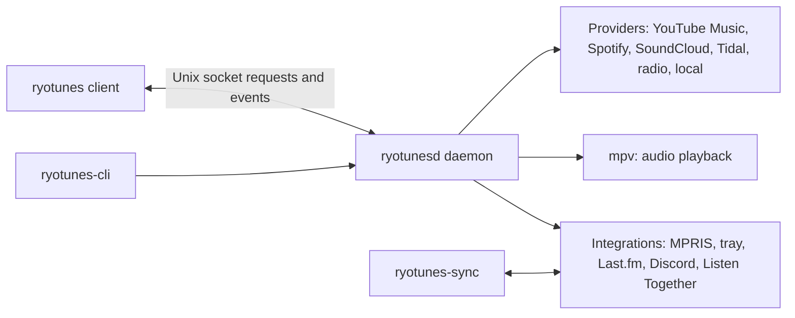

# Ryotunes

Ryotunes is Ryoku's music player for YouTube Music, Spotify, SoundCloud, Tidal, internet radio and local files. Playback is audio only. The interface is drawn in [Lithic](https://github.com/ryoku-dev/ryoku/tree/main/docs/lithic) and coloured by the live Ryoku palette.

Ryotunes 2.0 is a rewrite in Go of the 1.x Rust and Quickshell app; settings, library data and sign-ins carry over.

## The experience

| Surface | What it provides |
|---|---|
| Home | Continue listening, recent music, shortcuts and provider shelves |
| Search | Songs, albums, artists and playlists across the selected provider |
| Library | Liked music, account playlists, device playlists and local music |
| Radio | Searchable internet radio stations with live audio playback |
| Now playing | Artwork, track details, playback controls and access to the queue and lyrics |
| Lyrics | Synced and plain lyrics, click-to-seek and optional romanization |
| Queue | Manual ordering, continuation, shuffle, repeat and stop after current |
| Downloads | Audio downloads with bounded workers, progress and persistent history |
| Mini player | A compact second window backed by the same playback state |
| Integrations | MPRIS, media keys, tray, Last.fm, Discord and Listen Together |

Ryotunes does not play music videos.

## Lifecycle

| Action | Result |
|---|---|
| Close the window | The client closes while playback and active downloads continue in `ryotunesd` |
| Leave the daemon idle | With no client, playback, download or Listen Together room, the daemon exits after five minutes |
| Open Ryotunes again | The client reconnects to daemon-owned playback and queue state |
| Choose Quit | Playback stops, MPRIS unregisters, integrations close and the daemon exits |

## Install

### Ryoku

Ryotunes comes with Ryoku. If it was removed, install it again with:

```sh
ryoku-host pkg add ryotunes
```

### Arch Linux and CachyOS

Download the pacman package and matching checksum from the [latest release](https://github.com/ryoku-dev/ryotunes/releases/latest), then verify and install them:

```sh
sha256sum -c ryotunes-2.0.0-1-x86_64.pkg.tar.zst.sha256
sudo pacman -U ./ryotunes-2.0.0-1-x86_64.pkg.tar.zst
```

The package has pacman epoch `1`, although the release filename does not include it. See [the Arch install guide](docs/INSTALL-ARCH.md) for source builds and service details.

### Void Linux

From a clone or release source archive, run:

```sh
./release/void/install.sh
```

The installer verifies the release package, repacks it as an xbps package and installs it with the dependencies in `release/void/depends`. See [the Void install guide](docs/INSTALL-VOID.md).

## Architecture



The daemon owns playback, providers, storage and integrations. The client owns windows and presentation. See [the architecture guide](docs/ARCHITECTURE.md) and [persistence reference](docs/PERSISTENCE.md).

## Repository map

```text
cmd/
  ryotunes/          Gio desktop client
  ryotunesd/         playback daemon
  ryotunes-cli/      one request or event stream per invocation
  ryotunes-sync/     optional Listen Together relay
internal/
  client/            Lithic kit, connection, state, artwork and UI
  daemon/            protocol handlers and lifecycle wiring
  provider/          YouTube, Spotify, SoundCloud, Tidal, radio and local sources
  player/            mpv playback
  queue/             queue order, continuation and restore
  store/             SQLite and private files
  downloads/         download queue and workers
  lyrics/            lyric sources, parsing and romanization
  integrations/      MPRIS, tray, Last.fm, Discord and Listen Together
  protocol/          shared socket methods, events and wire types
release/             packages, user units, diagnostics and release gates
docs/                architecture, persistence, design, install and support
```

## Development

Build and test the Go tree:

```sh
go build ./...
go test ./...
```

Run a daemon without touching the installed socket or library:

```sh
root=$(mktemp -d)
mkdir -p "$root/run" "$root/data" "$root/cache" "$root/config" "$root/state"
XDG_RUNTIME_DIR="$root/run" \
XDG_DATA_HOME="$root/data" \
XDG_CACHE_HOME="$root/cache" \
XDG_CONFIG_HOME="$root/config" \
XDG_STATE_HOME="$root/state" \
go run ./cmd/ryotunesd
```

Render a demo frame without a display:

```sh
ryotunes --demo --png out.png
```

Contributors should read [CONTRIBUTING.md](CONTRIBUTING.md) and run `./release/check.sh` before sending a change.

## License

Ryotunes is distributed under [GPL-3.0-or-later](LICENSE). Ryotunes 1.x provenance and the 2.0 rebuild note are recorded in [UPSTREAM.md](UPSTREAM.md).
